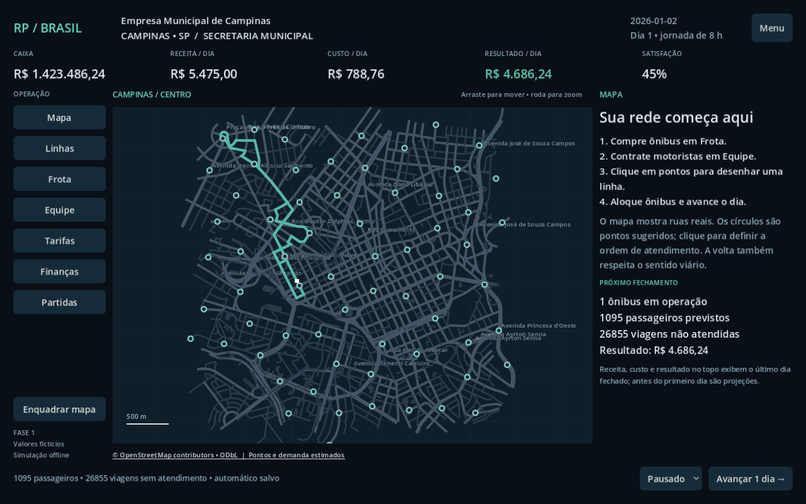

# Rotas do Poder: Brasil

Protótipo municipal em **Godot 4.5.1 / GDScript**, para Windows, em português.
**Somente a Fase 1 está implementada. A Fase 2 depende de solicitação explícita.**



## Jogar

Abra `project.godot` no Godot 4.5.1 e pressione **F6** na cena principal ou **F5**.
O complemento SQLite 4.6 já está incluído para Windows/Linux x86_64; não exige instalação.

Se você tem Python 3.11 e quer baixar o motor fixado para desenvolvimento:

```powershell
python tools/fetch_dependencies.py
& .\.tools\godot\Godot_v4.5.1-stable_win64.exe --path .
```

Esse download precisa de internet uma vez. A partida e o mapa funcionam offline.
O executável de distribuição Windows fica para a fase de empacotamento; esta entrega é um projeto jogável.

1. Escolha **Nova empresa**, selecione Campinas e dê um nome à empresa.
2. Em **Frota**, compre um ônibus; em **Equipe**, contrate um motorista.
3. Clique em dois ou mais pontos do mapa, na ordem desejada.
4. Em **Linhas**, escolha nome e quantidade de ônibus e salve.
5. Avance um dia ou selecione uma velocidade. Ajuste tarifas e acompanhe **Finanças**.
6. Use **Partidas** para salvar em um dos três espaços. Há um automático por fechamento diário.

Arraste para mover o mapa e use a roda para ampliar. Selecionar/editar uma linha destaca seu
circuito; a ida e a volta seguem conexões dirigidas reais. Motoristas limitam a operação:
um motorista atende um ônibus durante a jornada simplificada de oito horas.

## O que está entregue

- Menu, seleção de Campinas e criação de empresa municipal.
- Grafo viário real do centro de Campinas: 7.733 nós, 10.954 arestas dirigidas e 65 pontos sugeridos.
- Mapa vetorial offline, pan/zoom, criação, edição e remoção de linhas com aviso de impacto.
- Compra de ônibus, contratação de motoristas e alocação sem duplicação de frota.
- Tarifa com prévia, demanda compartilhada entre linhas, capacidade e viagens não atendidas.
- Simulação diária determinística, pausa e velocidades 1x/2x/5x/10x.
- Receitas, custos, caixa, resultado operacional, depreciação, lucro contábil e satisfação.
- Histórico diário, decisões e salvamento SQLite transacional, versionado, em vários espaços.

O recorte central **não é toda Campinas**. Pontos e demanda são estimados, e todos os valores
econômicos são fictícios e calibráveis em `data/balance.json`. Não há alegação de dados
oficiais de linhas, passageiros ou custos de operadores. Restrições OSM de conversão são
tratadas conservadoramente bloqueando as vias de entrada afetadas; isso pode alongar percursos.

## Testar

```powershell
python tools/check.py --godot .tools/godot/Godot_v4.5.1-stable_win64_console.exe
```

O comando verifica os dados/importador, importa o projeto e executa regressões headless.
Os testes usam um diretório temporário próprio, separado das partidas do jogador.
Incluem 365 dias, tarifa zero/alta, falta de motoristas, concorrência por passageiros,
limites de capacidade, caixa negativo, combustível, depreciação, roteamento e salvamento.

Para gerar imagens e verificar a interface com renderização real:

```powershell
& .\.tools\godot\Godot_v4.5.1-stable_win64_console.exe --path . --script tests/ui_smoke.gd
```

As imagens ficam em `build/qa/`. Esse teste usa dados de QA separados em `.tools/ui-qa.sqlite`.

## Dados e licenças

Código MIT; dados do mapa **© OpenStreetMap contributors**, sob
[ODbL 1.0](https://www.openstreetmap.org/copyright), com atribuição visível no mapa.
O recorte original comprimido acompanha o derivado, consulta, data e hash.
Identidade de Campinas/SP: [IBGE 3509502](https://www.ibge.gov.br/cidades-e-estados/sp/campinas).
Não foram incorporados limites municipais ou números populacionais nesta fase.

```powershell
python tools/import_osm.py            # reproduz o grafo offline
python tools/import_osm.py --download # atualiza explicitamente a fonte OSM
```

SQLite: [godot-sqlite 4.6](https://github.com/2shady4u/godot-sqlite/releases/tag/v4.6), MIT;
licença em `addons/godot-sqlite/LICENSE.md`. Binários Windows/Linux estão versionados.
Os demais sistemas operacionais não fazem parte desta entrega.

Plano, arquitetura, critérios e limites: [Fase 1](docs/FASE_1.md).
Visão completa: [Documento mestre](docs/DOCUMENTO_MESTRE.md).
